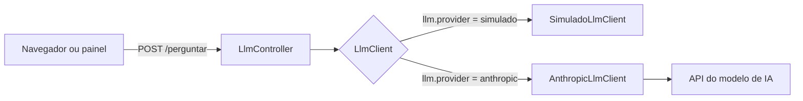

# 🤖 Projeto 02 - Integração com modelos de IA (LLM) usando Spring Boot


Uma API em Java com Spring Boot que recebe uma pergunta, envia para um modelo de IA e devolve a resposta. Ela funciona de dois jeitos:

| Modo | Chave de API | Custo | O que faz |
|------|--------------|-------|-----------|
| **Simulado** (padrão) | Não precisa | Nenhum | Devolve uma resposta pronta, sem chamar nenhuma API |
| **Real** | Precisa | Pago por uso | Chama a API de um provedor de IA |

## ✨ O que este projeto mostra

- **Chamada de uma API externa**: `AnthropicLlmClient` usa o `RestClient` do Spring para enviar a pergunta e ler a resposta em JSON.
- **Interface e duas implementações**: `LlmClient` define o contrato, e o Spring escolhe `SimuladoLlmClient` ou `AnthropicLlmClient` pela configuração (`@ConditionalOnProperty`).
- **Segredo fora do código**: a chave de API vem de uma variável de ambiente, e nunca do repositório.
- **DTOs com validação**: `PerguntaRequest` e `RespostaResponse` (records) definem o que a API recebe e devolve.
- **Tratamento de erros**: `GlobalExceptionHandler` devolve 400 (pedido inválido) e 502 (problema no modelo de IA) em JSON.
- **Testes sem custo**: os testes usam sempre o modo simulado.

## 🔄 Como funciona



## 📂 Estrutura

```
02-llm-integrations/
├── pom.xml
├── README.md
└── src/
    ├── main/
    │   ├── java/com/amintech/llm/
    │   │   ├── LlmIntegrationsApplication.java
    │   │   ├── client/
    │   │   │   ├── LlmClient.java
    │   │   │   ├── SimuladoLlmClient.java
    │   │   │   └── AnthropicLlmClient.java
    │   │   ├── config/LlmProperties.java
    │   │   ├── controller/LlmController.java
    │   │   ├── dto/
    │   │   │   ├── PerguntaRequest.java
    │   │   │   └── RespostaResponse.java
    │   │   └── exception/
    │   │       ├── GlobalExceptionHandler.java
    │   │       └── LlmException.java
    │   └── resources/
    │       ├── application.properties
    │       └── static/index.html
    └── test/java/com/amintech/llm/LlmControllerTests.java
```

## 🚀 Como executar

Pré-requisitos: Java 17 ou mais novo e Maven. Dentro desta pasta:

### Modo simulado (padrão)

Sem nenhuma configuração, o projeto liga no modo simulado:

```bash
mvn spring-boot:run
```

### Modo real

Para usar um modelo de verdade (PowerShell, na mesma janela em que vai rodar):

```powershell
$env:LLM_PROVIDER = "anthropic"
$env:ANTHROPIC_API_KEY = "COLE-SUA-CHAVE-AQUI"
mvn spring-boot:run
```

> [!WARNING]
> Nunca coloque a chave no código nem no GitHub.

> [!NOTE]
> Se outro projeto estiver rodando, pare-o antes (Ctrl + C), porque todos usam a porta 8080.

## 🔌 Endpoints

| Método | Rota | O que faz | Resposta |
|--------|------|-----------|----------|
| POST | `/perguntar` | Envia uma pergunta ao modelo e devolve a resposta | 200, 400 ou 502 |
| GET | `/status` | Mostra o provedor, o modelo e se a chave existe | 200 |

Exemplo de corpo (JSON) para `POST /perguntar`:

```json
{"pergunta": "Explique o que é Spring Boot em duas frases."}
```

Exemplo de resposta (modo simulado):

```json
{
  "resposta": "[Resposta simulada] Você perguntou: ...",
  "provedor": "simulado",
  "modelo": "nenhum (simulado)"
}
```

## 🧪 Como testar

| O quê | Como |
|-------|------|
| Painel de teste | `http://localhost:8080/` |
| Status da configuração | `http://localhost:8080/status` |
| Testes automáticos | `mvn test` |

## ⚠️ Limites (é um projeto de estudo)

- Cada pergunta é independente: o modelo não lembra das perguntas anteriores.
- A resposta chega inteira de uma vez (sem streaming) e não há nova tentativa em caso de falha.
- Os testes automáticos cobrem só o modo simulado.

> [!CAUTION]
> Não há login nem limite de uso. Quem alcançar a API gasta os créditos da sua chave, então não publique este projeto na internet sem proteção.
