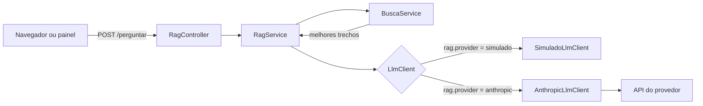

# 🔎 Projeto 03 - Sistema RAG com Spring Boot


Uma API em Java com Spring Boot que responde perguntas **usando os seus próprios documentos**. Primeiro ela procura os trechos mais parecidos com a pergunta, depois envia esses trechos ao modelo de IA. Isso se chama **RAG** (Retrieval-Augmented Generation). Ela funciona de dois jeitos:

| Modo | Chave de API | Custo | O que faz |
|------|--------------|-------|-----------|
| **Simulado** (padrão) | Não precisa | Nenhum | Devolve o trecho mais parecido, sem chamar nenhuma API |
| **Real** | Precisa | Pago por uso | Envia a pergunta e os trechos para a API de um provedor de IA |

## ✨ O que este projeto mostra

- **Os 3 passos do RAG**: `DocumentoService` divide os textos em trechos, `BuscaService` procura os mais parecidos e `RagService` monta o pedido para o modelo.
- **Busca por palavras (estilo TF-IDF)**: palavras raras valem mais do que palavras comuns. Funciona de graça e sem internet.
- **Fontes na resposta**: a API devolve de quais documentos e trechos a resposta veio.
- **Interface e duas implementações**: `LlmClient` define o contrato, e o Spring escolhe `SimuladoLlmClient` ou `AnthropicLlmClient` pela configuração (`@ConditionalOnProperty`).
- **Economia**: se nenhum trecho for encontrado, o modelo nem é chamado.
- **Segredo fora do código**: a chave de API vem de uma variável de ambiente, nunca do repositório.
- **DTOs com validação**: `PerguntaRequest` e `RespostaResponse` (records).
- **Tratamento de erros**: `GlobalExceptionHandler` devolve 400 (pedido inválido) e 502 (problema no modelo de IA) em JSON.
- **Testes sem custo**: os testes usam sempre o modo simulado.

## 🔄 Como funciona



## 📁 Estrutura

```
03-rag-systems/
├── pom.xml
├── README.md
└── src/
    ├── main/
    │   ├── java/com/amintech/rag/
    │   │   ├── RagApplication.java
    │   │   ├── client/        (LlmClient, SimuladoLlmClient, AnthropicLlmClient)
    │   │   ├── config/        (RagProperties)
    │   │   ├── controller/    (RagController)
    │   │   ├── dto/           (PerguntaRequest, RespostaResponse, Trecho)
    │   │   ├── exception/     (GlobalExceptionHandler, LlmException)
    │   │   └── service/       (DocumentoService, BuscaService, RagService)
    │   └── resources/
    │       ├── application.properties
    │       ├── docs/          (documentos .md usados na busca)
    │       └── static/index.html
    └── test/java/com/amintech/rag/RagControllerTests.java
```

## 🚀 Como executar

Pré-requisitos: Java 17 ou mais novo e Maven. Dentro desta pasta:

### Modo simulado (padrão)

```powershell
mvn spring-boot:run
```

### Modo real

Para usar um modelo de verdade (PowerShell, na mesma janela em que vai rodar):

```powershell
$env:LLM_PROVIDER = "anthropic"
$env:ANTHROPIC_API_KEY = "COLE-SUA-CHAVE-AQUI"
mvn spring-boot:run
```

> [!WARNING]
> Nunca coloque a chave no código nem no GitHub.

> [!NOTE]
> Se outro projeto estiver rodando, pare-o antes (Ctrl + C), porque todos usam a porta 8080.

## 📚 Usando os seus documentos

Coloque arquivos `.md` na pasta `src/main/resources/docs/` e rode o projeto de novo. Os parágrafos são separados por uma linha em branco e agrupados em trechos (tamanho em `rag.chunk-size`).

## 🔌 Endpoints

| Método | Rota | O que faz | Resposta |
|--------|------|-----------|----------|
| POST | `/perguntar` | Procura nos documentos e responde, com as fontes | 200, 400 ou 502 |
| GET | `/status` | Mostra o provedor, o modelo, se a chave existe e quantos documentos e trechos foram lidos | 200 |
| GET | `/documentos` | Lista os documentos e o número de trechos de cada um | 200 |

Exemplo de corpo (JSON) para `POST /perguntar`:

```json
{"pergunta": "O que é RAG?"}
```

Exemplo de resposta (modo simulado):

```json
{
  "resposta": "[Resposta simulada] Achei 2 trecho(s) nos documentos. O mais parecido diz: ...",
  "provedor": "simulado",
  "modelo": "nenhum (simulado)",
  "fontes": [
    {"documento": "o-que-e-rag.md", "posicao": 1, "texto": "...", "pontuacao": 2.31}
  ]
}
```

## 🧪 Como testar

| O quê | Como |
|-------|------|
| Painel de teste | `http://localhost:8080/` |
| Status da configuração | `http://localhost:8080/status` |
| Testes automáticos | `mvn test` |

## ⚠️ Limites (é um projeto de estudo)

- A busca é por **palavras**, não por significado. Se a pergunta usar palavras diferentes das do texto, ela pode não achar o trecho. O próximo passo seria usar **embeddings** (busca por significado).
- Os documentos são lidos uma vez, quando o programa inicia. Se mudar um arquivo, reinicie.
- Cada pergunta é independente: o modelo não lembra das perguntas anteriores.
- A resposta chega inteira de uma vez (sem streaming) e não há nova tentativa em caso de falha.
- Os testes automáticos cobrem só o modo simulado.

> [!CAUTION]
> Não há login nem limite de uso. Quem alcançar a API gasta os créditos da sua chave, então não publique este projeto na internet sem proteção.
